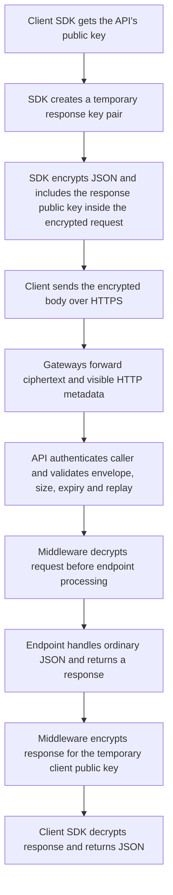

# EnvelopeKit

**A language-neutral protocol and developer toolkit for encrypted HTTP payloads.**

> **Status: early .NET implementation, not production-ready.** The repository now contains provisional JOSE primitives, P-256 key helpers, signed key-manifest validation, and an in-progress encrypted HTTP client. The wire protocol, cryptographic profile, API middleware, replay integration, interoperability vectors and package APIs are not final. Do not use this project to protect real data.

EnvelopeKit is being designed to encrypt selected JSON request bodies before they pass through HTTP gateways, then decrypt them inside the API before application processing. The API can encrypt its JSON response for the calling app to decrypt.

The first implementation targets .NET. The cryptographic and key-manifest foundation is in main, and the client HTTP pipeline is being developed. ASP.NET Core middleware, replay-store integration and a stable cross-language protocol remain to be built. Browser, mobile and other language clients can follow after the .NET profile is stable.

## At a glance

| Question | Current design |
| --- | --- |
| What is protected? | Selected JSON HTTP request and response bodies |
| Where does encryption start? | In the calling application, through a client SDK |
| Where is a request decrypted? | In the API service, through ASP.NET Core middleware |
| Can an API gateway read the body? | It should see ciphertext if it only forwards the request |
| Can the API read the body? | Yes. The API must decrypt it to process the request |
| Does this replace HTTPS? | No. HTTPS remains required |
| Does encryption authenticate the caller? | No. API authentication and authorisation remain separate |
| What is the first implementation? | .NET client integration and ASP.NET Core middleware |
| Is it ready to use? | No. The protocol is still being designed |

## The problem EnvelopeKit addresses

TLS encrypts data between two TLS endpoints. In many systems, TLS ends at a gateway, load balancer, reverse proxy or service mesh. That component may then read the HTTP body before forwarding the request to the application.

That can be an intentional trust boundary. For example, a service may want an edge gateway to route, rate-limit and authenticate requests while limiting access to sensitive JSON bodies. Payload encryption is one possible way to reduce what those intermediaries can read.

EnvelopeKit's intended boundary is:

1. The client encrypts a selected JSON body for the API.
2. Intermediaries forward the encrypted body.
3. The API authenticates the caller, validates the message and decrypts it.
4. The application processes normal JSON.
5. The API encrypts the response for the client.
6. The client decrypts the response and returns normal JSON to its caller.

This protects the body across the path between the client and the API decryption boundary. It does not protect the body from the client or the API itself.

## Goals

- Keep selected JSON bodies unreadable to forwarding intermediaries.
- Detect ciphertext modification.
- Reject expired and replayed requests.
- Give .NET developers a client SDK and ASP.NET Core middleware.
- Publish a versioned, language-neutral protocol with test vectors.
- Support key identifiers, key rotation and interoperable key discovery.
- Make failure behaviour and plaintext handling explicit.

## Non-goals

EnvelopeKit is not intended to:

- Replace HTTPS/TLS.
- Identify or authorise a caller. Encryption to a public key is not proof of identity.
- Hide the URL, HTTP method, headers, status code, timing or approximate body size.
- Protect plaintext from the API process, the client application or a compromised device.
- Prevent XSS, malware, credential theft, denial of service or business-logic abuse.
- Replace OAuth/OIDC, API keys, mutual TLS, access control, input validation or rate limiting.
- Encrypt every possible HTTP body type in its first version.

## Proposed architecture

The proposal has four logical parts. The exact package boundaries may change.

| Part | Responsibility |
| --- | --- |
| Protocol specification | Define the envelope, cryptographic profile, versioning, key identifiers, replay fields and interoperability rules |
| .NET client SDK | Obtain the API's public encryption key, encrypt eligible request bodies, retain the temporary response private key and decrypt responses |
| ASP.NET Core middleware | Validate incoming envelopes, decrypt requests before normal endpoint processing, and encrypt eligible JSON responses |
| Replay/key services | Resolve server keys and atomically record request identifiers so duplicates can be rejected across API instances |

The cryptographic operations should use established standards and maintained libraries. EnvelopeKit should not invent its own cryptographic primitives or message format.

## End-to-end flow

The diagram shows the intended exchange. It is a design sketch, not an implemented protocol.



The response public key is intended to be inside the encrypted request. This lets the API learn the key only after it has decrypted the request. The client keeps the matching temporary private key for the response. The key lifetime and exact key agreement mechanism are still open design decisions.

## What an intermediary can and cannot see

When correctly deployed, a forwarding gateway should see the encrypted body rather than its JSON contents. It can still see or act on information outside that body.

| Data or action | Expected visibility to a forwarding gateway |
| --- | --- |
| Encrypted JSON body | Ciphertext |
| Destination host and path | Visible |
| HTTP method and headers | Visible |
| Authentication headers | Visible unless separately protected |
| Response status and timing | Visible |
| Approximate encrypted body size | Visible |
| Data after API decryption | Not available at the gateway, unless the gateway is also inside the API trust boundary |

The API service, its middleware and any components that receive plaintext after decryption can read the request. Logs, traces, exception capture and monitoring must be configured so they do not unintentionally record decrypted bodies.

## Security properties and boundaries

### Confidentiality

Payload encryption is intended to protect body contents from intermediaries that can observe traffic but do not hold the API's private decryption key. The API itself can read the body because it needs the data to perform its work.

If the API host, application process, client device or web application is compromised, payload encryption does not keep plaintext safe at the point where that system uses it.

### Integrity

The selected authenticated-encryption construction should reject modified ciphertext. This detects changes to an encrypted message. It does not prove which caller created the message: anyone with the API's public key can create ciphertext.

### Authentication and authorisation

The API must authenticate and authorise the caller independently. Existing mechanisms such as OAuth 2.0 or OpenID Connect can remain in place. Authentication headers are outside the encrypted body unless a separate design explicitly covers them.

### Replay protection

A captured valid ciphertext may be resent. The protocol is intended to include a unique request identifier and a short validity window. The server must reject an identifier that has already been accepted during that window. In a multi-instance deployment, the replay check must use shared state or another mechanism that prevents two instances from accepting the same request concurrently.

The exact request identifier format, time tolerance, storage interface and relationship to application idempotency are not final.

### Web and mobile clients

A browser cannot hide plaintext from hostile code running in the same origin. Non-exportable Web Crypto keys can make raw key extraction harder, but malicious same-origin code may still ask the browser to decrypt data or read the result. XSS prevention, a strict Content Security Policy, dependency control and short-lived keys reduce risk, but do not remove it.

Mobile platform key stores can reduce the risk of private-key extraction from device storage. They cannot hide plaintext from a compromised application while it is using the data.

## Request and response processing

### Client-side request

The client integration is intended to:

1. Retrieve the API's public encryption key set over HTTPS.
2. Select a supported key by its key identifier.
3. Generate a temporary response key pair for the exchange.
4. Serialize the request body as JSON.
5. Add the response public key and protocol metadata to the encrypted request content.
6. Encrypt the message, attach the envelope to the HTTP request and send it over HTTPS.
7. Decrypt the encrypted response using the temporary private key, then deserialize the JSON.

The client must not ship a shared secret that is expected to remain secret. Browser and mobile applications are distributed to users and cannot keep a global client secret confidential.

### API-side request

The API integration is intended to:

1. Apply transport limits and authenticate the caller using normal API mechanisms.
2. Reject unsupported versions, malformed envelopes and oversized bodies.
3. Resolve the server private key from the envelope's key identifier.
4. Check the message expiry and atomically reject reused request identifiers.
5. Decrypt the request body and expose ordinary JSON to model binding and the endpoint.
6. Encrypt eligible JSON responses for the response public key supplied inside the request.

The ordering relative to ASP.NET Core authentication, authorisation, exception handling, compression and endpoint routing must be tested and documented. Streaming bodies and responses are out of the first prototype's scope.

## Key discovery and lifecycle

The server needs a public key for clients and a private key for decryption. The public key may be published through a key-discovery endpoint. The response should identify the key and protocol profile. Clients should retrieve it over HTTPS and cache it only according to a documented lifetime.

Private keys must remain on the server and should be held by a key-management service, HSM or protected key store appropriate to the deployment. They must not appear in source control, client packages, configuration committed to the repository or logs.

Key rotation needs to support a transition period in which the server can decrypt messages using an older key while clients move to a newer public key. The protocol must define how retired keys are removed, how caches are refreshed and what clients do when a key identifier is unknown.

The first version's key type, storage abstraction, discovery document and rotation schedule have not been selected.

## Protocol and cryptography choices

JWE (RFC 7516) is a candidate because it standardises JSON Web Encryption. HPKE (RFC 9180) is another candidate for hybrid public-key encryption. Neither has been selected for EnvelopeKit.

The decision must consider:

- Support in .NET, browser Web Crypto or JavaScript libraries, and expected mobile platforms.
- A narrow, explicit algorithm profile that avoids algorithm negotiation surprises.
- Authenticated encryption and safe nonce handling.
- How a client public key is represented and bound to one response.
- Key discovery and rotation.
- Message size, encoding overhead and performance.
- Independent implementations and test vectors.

No cryptographic profile should be considered final until the interoperability prototype works across at least two independent implementations and receives security review.

## Planned .NET developer experience

The planned first release is expected to have two NuGet packages:

### `EnvelopeKit.Http`

A client package for .NET applications using `HttpClient`. Its intended responsibilities are request encryption, key retrieval and caching, response decryption, and clear protocol-specific errors.

It should not replace the caller's authentication setup, make authorization decisions or require a global shared secret.

### `EnvelopeKit.AspNetCore`

A server package for ASP.NET Core APIs. Its intended responsibilities are incoming-envelope validation, decryption before normal JSON processing, response encryption, key resolution and replay-store integration.

The public configuration API, middleware registration order, endpoint opt-in model and supported .NET target frameworks have not been designed yet.

### Illustrative usage only

The following is a conceptual sketch to explain the intended ergonomics. It is **not real code** and does not correspond to an existing package API:

```csharp
// Concept only. EnvelopeKit packages and APIs do not exist yet.
services.AddEnvelopeKitClient(options =>
{
    options.KeySetUri = new Uri("https://api.example.test/.well-known/envelopekit-keys");
});

services.AddHttpClient("orders")
    .AddEnvelopeKit();

services.AddEnvelopeKitServer(options =>
{
    options.KeyResolver = /* server-side private key resolver */;
    options.ReplayStore = /* shared replay store for this deployment */;
});
```

The final integration may use different names and extension points. It must make unsupported or unprotected requests visible to the developer rather than silently implying they are encrypted.

## Initial supported scope

The first prototype is intended to cover bounded JSON request and response bodies on explicitly enabled endpoints.

These are outside the initial scope unless later design work establishes a safe and useful approach:

- Streaming responses and request bodies.
- Server-Sent Events and WebSockets.
- Multipart form data and large file uploads.
- Arbitrary binary payloads.
- Transparent encryption of every route without application opt-in.
- Protection from a compromised client or API process.

## Failure handling and operational requirements

The implementation must fail closed for endpoints configured to require encryption. It should not silently pass malformed ciphertext to application code as if it were plaintext JSON.

The design must define how clients and servers handle:

- Missing, malformed or unsupported envelopes.
- Unknown or retired key identifiers.
- Authentication failure.
- Expired messages and duplicate request identifiers.
- Invalid authentication tags or decryption failures.
- Oversized bodies and unsupported content types.
- API exceptions before or after response encryption.

Error responses should not expose private key details, plaintext, cryptographic internals or sensitive validation distinctions. Exact HTTP status codes and retry behaviour remain to be specified.

Deployments need configurable body limits, replay-state retention, key rotation, health checks and safe observability. Metrics should report counts and categories without recording plaintext or secrets.

## Compatibility and versioning

The wire protocol, not a particular .NET package version, is the interoperability contract. Protocol versions and key identifiers should be explicit. Cryptographic profiles must be allow-listed and must not be selected by blindly trusting values in an untrusted message.

Before a protocol version is called stable, the project should publish:

- A normative message-format specification.
- Positive and negative test vectors.
- Cross-implementation interoperability results.
- Version negotiation and deprecation rules.
- A compatibility policy for server and client releases.

## Roadmap

1. Finalise the threat model and document the intended trust boundary.
2. Compare JWE and HPKE against the target platforms and publish a protocol decision record.
3. Define key discovery, key rotation, response-key handling and replay semantics.
4. Build a small interoperability prototype and publish test vectors.
5. Implement the .NET client and ASP.NET Core middleware.
6. Add samples for local development, distributed replay storage, key rotation and error handling.
7. Add browser and mobile clients after the protocol is stable.
8. Arrange independent security review before a production release.

## Development setup

The repository currently contains project scaffolding only. The sample API exposes a health endpoint, and the sample client is a placeholder. Neither demonstrates encrypted HTTP traffic.

Requirements: .NET 10 SDK.

```bash
dotnet build EnvelopeKit.sln
dotnet run --project samples/EnvelopeKit.SampleApi
dotnet run --project samples/EnvelopeKit.SampleClient
```

The build confirms the scaffold compiles. It does not indicate that payload encryption or replay protection is available.

### Solution layout

| Path | Intended responsibility |
| --- | --- |
| `src/EnvelopeKit.Protocol` | Protocol types and rules shared by the .NET packages |
| `src/EnvelopeKit.Http` | Client-side HTTP integration |
| `src/EnvelopeKit.AspNetCore` | ASP.NET Core server integration |
| `samples/EnvelopeKit.SampleApi` | Placeholder ASP.NET Core host |
| `samples/EnvelopeKit.SampleClient` | Placeholder client application |

## Contributing

EnvelopeKit is at the design stage. Useful early contributions include threat-model review, protocol review, interoperability research and feedback on the proposed developer experience.

Do not introduce custom cryptographic primitives or make unsupported security claims. Proposed changes to the wire format or cryptographic profile should include rationale, threat impact, interoperability considerations and test vectors.

A private security-reporting contact and supported disclosure process will be published before the first production release. Until then, do not include sensitive information in public issues.

## Licence

EnvelopeKit is licensed under the [MIT License](LICENSE).

## Acknowledgements

The project intends to build on established cryptographic standards and maintained libraries rather than inventing its own cryptography.
