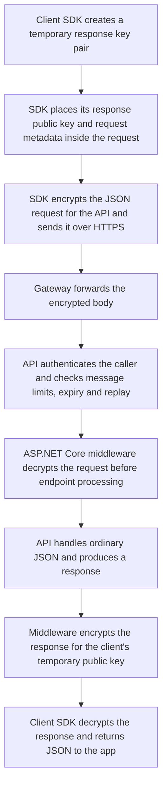

# EnvelopeKit

**A language-neutral protocol and developer toolkit for encrypted HTTP payloads.**

> **Project status: design stage.** EnvelopeKit is not implemented and is not ready for production use. The protocol, algorithms, package APIs and license are not final.

EnvelopeKit is intended to help an application encrypt JSON request bodies before they pass through HTTP gateways, then let the API decrypt them before processing. The API can encrypt its JSON response so the calling app can decrypt it.

HTTPS remains required. EnvelopeKit is an additional payload-protection layer, not a replacement for TLS or API authentication.

## Why EnvelopeKit?

TLS protects traffic between two endpoints. In many deployments, TLS terminates at a gateway, load balancer, proxy or service mesh before the request reaches the application. Those components may be able to read the HTTP body.

EnvelopeKit aims to keep selected JSON bodies encrypted across those intermediaries. The API decrypts a request at its application boundary, processes it as normal JSON, then encrypts the response for the client.

The initial implementation is planned for .NET, with a client SDK and ASP.NET Core middleware. The wire protocol will be documented independently of .NET so clients and servers in other languages can interoperate later.

## Intended goals

- Protect selected JSON request and response bodies from intermediaries that forward the traffic but should not read its contents.
- Detect changes to encrypted messages.
- Reject expired or replayed requests.
- Provide a straightforward .NET client integration and ASP.NET Core middleware.
- Define a versioned, language-neutral message format with interoperability examples.
- Support server key identification and planned key rotation.

## What EnvelopeKit does not do

- Replace HTTPS/TLS.
- Authenticate a caller or grant permissions. Use the API's existing authentication and authorisation mechanisms.
- Hide HTTP metadata such as the destination, route, headers, status code, timing or approximate body size.
- Hide plaintext from the API while it processes the request or creates its response.
- Protect plaintext from a compromised client, API process, or malicious code running in a web app.
- Replace input validation, rate limiting, access controls, secure logging or other API security controls.

Anyone who can obtain the API's public encryption key can encrypt a message for that API. A valid encrypted message therefore does not, by itself, prove who sent it. Authentication must be checked separately.

## Proposed message flow

The details below describe the intended design and may change as the protocol is reviewed.

The client's response public key is intended to travel inside the encrypted request. The API can read it after decrypting the request and use it to encrypt the response. The client retains the corresponding temporary private key to decrypt that response.

## Planned .NET components

### `EnvelopeKit.Http`

The client package is intended to integrate with .NET HTTP clients. It would handle public-key discovery, request-body encryption, response-body decryption and protocol errors, while leaving application authentication and HTTP transport configuration to the caller.

### `EnvelopeKit.AspNetCore`

The server package is intended to provide ASP.NET Core middleware. It would validate the encrypted envelope, decrypt the request before normal JSON processing, and encrypt eligible JSON responses.

Middleware placement and behaviour around authentication, exception handling, response buffering and endpoint routing will be specified before implementation.

### Future language clients

Once the protocol and .NET implementation are stable, separate clients may be developed for browser JavaScript and mobile platforms. Browser clients need particular care: code running in the same web application can access plaintext after decryption.

## Proposed protocol considerations

The protocol will need to define:

- A protocol version and server key identifier.
- The encrypted message representation and an allow-list of cryptographic algorithms.
- Request identifiers, creation time and expiry.
- How replay attempts are detected across multiple API instances.
- How the client supplies a temporary response public key.
- Key discovery, rotation and retirement.
- Error responses that do not disclose sensitive cryptographic details.
- Body size limits, content types and behaviour for unsupported requests.

JWE (RFC 7516) is a candidate message format because it is an established JSON encryption standard. It is not yet a final decision. No custom cryptographic format or algorithm should be introduced without a documented design review.

## Security and deployment model

### Transport security

All traffic must still use HTTPS. Payload encryption does not protect HTTP headers, URLs, traffic patterns or data outside the encrypted body.

### Authentication and authorisation

The API must authenticate and authorise the caller independently of payload decryption. Existing mechanisms such as OAuth 2.0 or OpenID Connect can remain in place.

### Integrity and replay protection

Authenticated encryption can detect tampering with ciphertext, but it does not identify the sender. The protocol must also bind requests to an expiry and unique identifier. A distributed API deployment will need a shared replay store or another documented way to reject duplicate requests.

### Key management

The server's private decryption keys must remain on the server and be stored using an appropriate key-management service or protected key store. Public keys need stable identifiers so servers can rotate keys while clients and deployments transition safely. Private keys must never be placed in source control, client applications or logs.

### Plaintext handling

The API must decrypt requests to process them. Application logs, tracing, exception reporting and monitoring should avoid recording decrypted bodies unless that is explicitly required and protected. Encryption at the network boundary cannot protect data from a compromised client or API process.

### Web and mobile clients

A browser app cannot keep plaintext safe from hostile code running in that app's origin. Strong XSS prevention, a restrictive Content Security Policy, careful dependency management and short-lived keys can reduce exposure, but do not remove this limitation. Mobile secure key storage can reduce the risk of private-key extraction from device storage, but cannot hide plaintext from a compromised app while it uses the data.

## Initial scope

The first prototype is intended to cover bounded JSON request and response bodies on explicitly enabled endpoints.

Streaming responses, Server-Sent Events, WebSockets, multipart uploads, large file transfers and arbitrary binary bodies are outside the initial scope unless later design work establishes a safe and useful approach.

## Development roadmap

1. Write a threat model and protocol decision records.
2. Compare candidate standard formats and verify cross-platform library support.
3. Create interoperability test vectors and a small .NET-to-.NET prototype.
4. Implement the .NET client package and ASP.NET Core middleware.
5. Add examples for key discovery, key rotation, authentication integration and replay storage.
6. Add browser or mobile clients only after the protocol is stable.
7. Arrange independent security review before describing a release as production-ready.

## Contributing

The project is at the design stage. Contributions should begin with discussion of the threat model, protocol or interoperability requirements. Do not submit new cryptographic primitives or algorithms without prior design review.

Security issues should be reported privately to the maintainer rather than opened as public issues. A security reporting process will be added before the first public release.

## Licence

No licence has been selected yet. Until a licence file is added, assume that no permission is granted to use, modify or redistribute the project.

## Acknowledgements

EnvelopeKit is intended to build on established cryptographic standards and maintained libraries rather than inventing its own cryptography.
